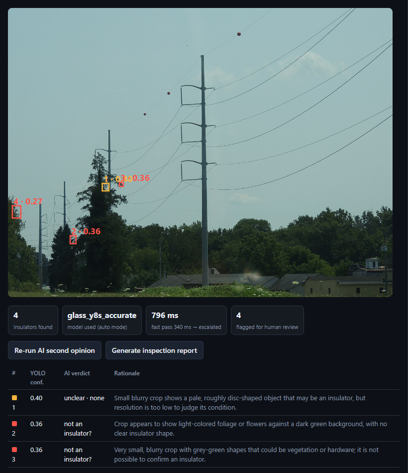
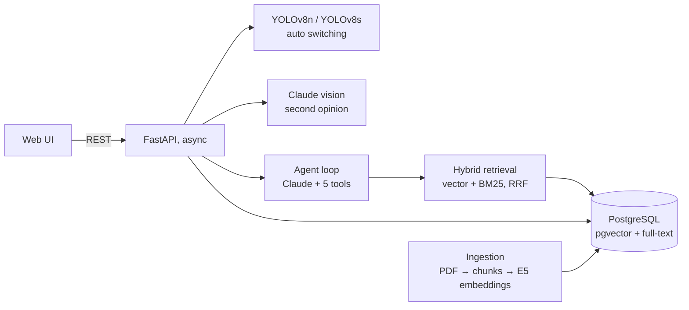

# Insulator Inspection Copilot

[](https://github.com/tejachirravuri/insulator-inspection-copilot/actions/workflows/ci.yml)

An AI assistant for **powerline insulator inspection**. YOLOv8 models find insulators in drone
images, a vision LLM gives a second opinion on their condition and flags uncertain cases for a
human, and a tool-calling agent answers questions from the inspection database and from
maintenance manuals, with citations. Built with FastAPI, PostgreSQL + pgvector, Claude, Docker,
GitHub Actions and Azure.

The detectors are the YOLOv8n / YOLOv8s models from my master's thesis on dynamic model
switching for real-time UAV insulator inspection (TU Chemnitz).


*A real answer from the agent: it queried the inspection database (which detections are flagged
and why), searched the manuals, cited the passages `[S1]`, `[S4]`, and shows its tool calls,
tokens and cost (here 3 tool calls, 12.9k tokens, $0.069).*



*Why the second opinion matters (real run on a CC BY 2.0 photo of a US 230 kV line,
[source](demo/images/ATTRIBUTION.md)): the glass-disc detector, trained on other imagery, found
four small low-confidence objects and missed the post insulators on the poles. The vision
review judged three of the four not to be insulators (two clearly foliage, one undecidable;
red) and flagged the remaining one for a human (amber). Domain shift is caught instead of
being reported as findings.*

## What it does

1. **Detect** insulators with YOLOv8. *Auto* mode runs the fast YOLOv8n first and switches to
   the accurate YOLOv8s only when the fast result is uncertain (the thesis idea in miniature).
2. **Second opinion:** Claude looks at the detected crops and returns, per insulator, a
   condition (glaze burn, broken shed, contamination, ...), a severity and a
   `needs_human_review` flag, as schema-validated JSON. Unclear crops are flagged, not guessed.
3. **Ask:** an agent with five tools (manual search, inspections, statistics, review) answers
   questions; numbers come from SQL, manual statements carry `[S#]` citations.
4. **Report:** generates a Markdown inspection report with findings, actions and citations.
5. **MCP server:** the same tools for any Model Context Protocol client (Claude Desktop,
   Claude Code, IDE agents). Read-only by design: external agents can query, not spend.

## Architecture



One PostgreSQL database holds the manuals (text, `vector(384)` embeddings with an HNSW index,
a generated `tsvector` with a GIN index), the images, detections and reviews.
Design decisions and their reasons: [docs/WALKTHROUGH.md](docs/WALKTHROUGH.md).

## Results

All numbers below come from runs in this repository; single runs on one machine unless stated.

**Retrieval** (931 chunks, top 10 per method, MRR@10 / Hit@5;
[eval/results/](eval/results/)):

| Method | Development set (53 q.) | Held-out set (21 q.) |
|---|---|---|
| Keyword, PostgreSQL `ts_rank_cd` | 0.33 / 0.42 | 0.27 / 0.48 |
| Keyword, **BM25 in SQL** | 0.60 / 0.70 | **0.65 / 0.76** |
| Vector (pgvector, multilingual-e5-small) | 0.50 / 0.66 | 0.61 / 0.67 |
| Hybrid RRF (vector + `ts_rank_cd`) | 0.51 / 0.64 | 0.57 / 0.67 |
| **Hybrid RRF (vector + BM25)**, default | **0.62 / 0.81** | 0.61 / 0.76 |

How this was measured, in order:
1. The first evaluation showed weak keyword search. Diagnosis: PostgreSQL's `ts_rank_cd` has no
   inverse document frequency, so common words ("test" occurs in 370 of 931 chunks) outrank
   rare, decisive ones ("stick": 29).
2. **Before** changing anything, 21 new questions on topics the development set does not cover
   were written and committed (`eval/heldout_questions.jsonl`, see the Git history), together
   with a decision rule: switch the default only if vector + BM25 beats the old hybrid on
   **both** sets.
3. BM25 was implemented in SQL on the existing full-text index with the standard parameters
   k1 = 1.2, b = 0.75, not tuned. Keyword MRR roughly doubled on both sets and the rule was met.

Caveats: on the held-out set BM25 alone is slightly ahead of the hybrid; with 21 questions a
difference of 0.04 MRR is about one question. BM25 computes its statistics per query: median
180 ms per search versus 30 ms for `ts_rank_cd` (20 queries, laptop); precomputed statistics in
materialized views would remove most of that.

**Detection latency** (CPU, Intel i5-10210U laptop, 10 images, auto mode): fast-only runs
135-218 ms; runs that escalated to the accurate model 488-583 ms; 3 of 10 images escalated.

**Cost and latency of LLM features** (Claude Opus 5.5):

| Action | Tool calls | Tokens | Cost |
|---|---|---|---|
| Vision review of 7 crops (one request, 7.2 s) | - | 1.5k | $0.015 |
| Question on flags + manuals (screenshot above) | 3 | 12.9k | $0.069 |
| Manual question on the Azure deployment (13 s end to end) | 2 | 8.2k | $0.048 |

## Run it

Requires Docker. Put a Claude API key in `.env` (`ANTHROPIC_API_KEY=...`, see `.env.example`).

```bash
docker compose up --build
```

Open http://localhost:8000. On the first start the container downloads the public-domain
manuals (SHA-256 verified), chunks and embeds them (931 chunks; about 5 minutes on a laptop
CPU, measured on a fresh stack).

The thesis YOLO weights are **not** in this repository (dataset licence and pending publication).
Without them the manual search and the agent work, and image upload returns a clear 503
message. With weights, place `*.pt` files in `models/` before building (names in
[detection.py](src/inspection_copilot/detection.py)); the first start then also runs detection
on the four openly licensed demo images in [demo/images](demo/images/ATTRIBUTION.md).

### Use the tools from Claude Desktop (MCP)

With the database running and the package installed, add this to Claude Desktop's
`claude_desktop_config.json` (adjust the path):

```json
{
  "mcpServers": {
    "insulator-inspection": {
      "command": "C:\\path\\to\\insulator-inspection-copilot\\.venv\\Scripts\\python.exe",
      "args": ["-m", "inspection_copilot.mcp_server"]
    }
  }
}
```

Claude then sees `search_manuals`, `list_inspections`, `get_inspection` and
`inspection_statistics`. Verified with the MCP SDK client over stdio: tool discovery, a manual
search and the statistics call.

### Development

```bash
python -m venv .venv && .venv\Scripts\activate          # Windows
pip install torch torchvision --index-url https://download.pytorch.org/whl/cpu
pip install -e ".[ml,dev]"
docker compose up -d db
alembic upgrade head
pytest                                        # 37 tests; DB tests use a separate test database
python -m inspection_copilot.ingest           # manuals into the dev database
python -m inspection_copilot.eval_retrieval   # retrieval evaluation
uvicorn inspection_copilot.main:app --reload
```

## Evaluation method

* **Question set:** 53 questions drafted with an AI assistant (Claude) from the manuals, each
  with a short verbatim **evidence quote** and its page. `--check` verifies every quote occurs
  in its document on the stated page. A retrieved chunk counts as correct if it contains the
  quote (ignoring case and whitespace, because PDF extraction sometimes splits words).
  Labelling by quote instead of chunk id keeps the set valid when chunking changes.
* **Bias control:** questions written from the text favour keyword search, so 17 of them are
  `paraphrase` questions that avoid the source wording; results are reported per category.
* **Held-out set:** 21 questions on other topics, committed before BM25 was implemented, so
  the method change could not be tuned to them.
* **Agent tests** use a scripted fake Claude client (no key, no cost): parallel tool results,
  unknown tools, step cap, refusals. CI runs lint, migrations and all tests against PostgreSQL
  with pgvector and builds the Docker image.

## Deployment (Azure)

Infrastructure as code in [infra/main.bicep](infra/main.bicep): private Container Registry,
managed identity (AcrPull, no registry password), PostgreSQL Flexible Server with pgvector,
Container Apps scaling to zero. Secrets are Container Apps secrets. A public URL is protected by
an access code and a daily Claude budget ($1/day) enforced from a usage table.
`infra/deploy.sh` creates the resources, `infra/release.sh` builds, pushes and switches the app.
The live demo runs in the EU (app: Sweden Central, database: France Central); access code on
request. What went wrong during deployment and how it was solved is in the
[walkthrough](docs/WALKTHROUGH.md#5-deployment-on-azure).

## Knowledge base

US Army TM 5-684 *Electrical Exterior Facilities* (1996) and US Bureau of Reclamation FIST
volumes 3-18 to 3-28 and 4-1B (2000-2005): US federal government works, public domain in the
US ([data/sources.toml](data/sources.toml)). The PDFs are downloaded, not stored here.

## Limitations

* The manuals are older US documents, not current European standards (DIN EN / IEC); the agent
  says so when it matters.
* The thesis detectors were trained on one dataset. On other imagery they degrade (domain
  shift): on the openly licensed demo photos they found 0, 1, 3 and 4 objects, missed post
  insulators and produced low-confidence false positives that the vision review rejected.
* The YOLO models localise insulators; they do not classify defects. Condition assessment comes
  from the vision LLM and is an AI second opinion that flags cases for a qualified person.
* On small or blurry aerial crops the vision review often answers "unclear" by design.
* The retrieval questions were drafted with an AI assistant; the held-out set is small (21).
* PDF extraction sometimes mixes two-column text, so a chunk's section label can be one
  paragraph off.
* Latency and cost figures are single runs, not benchmarks.

## Project layout

```
src/inspection_copilot/   detection, vision review, retrieval, agent, API, MCP server, UI
migrations/               Alembic schema migrations
eval/                     question set and results
infra/                    Bicep and deployment scripts
tests/                    pytest suite (unit + PostgreSQL integration)
docs/WALKTHROUGH.md       design decisions, deployment notes, interview Q&A
```

## License

Code: MIT. Documents and images keep their own licences (see the files referenced above).
