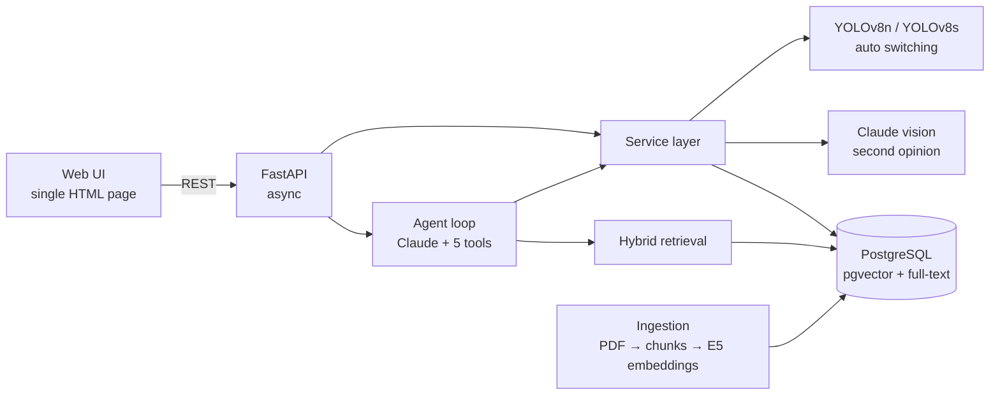
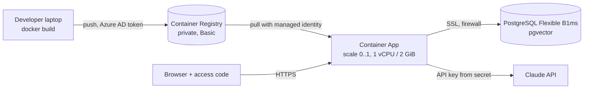

# Walkthrough: how the Insulator Inspection Copilot works

This document explains every part of the system and why it is built that way. Numbers marked
*measured* come from runs on the development laptop (Intel i5-10210U, CPU only); they are
single runs, not benchmarks, unless stated otherwise.

## 1. What it does

An inspector uploads a drone image of a power line. The system

1. **finds the insulators** with the YOLOv8 models from my master's thesis,
2. lets a **vision LLM give a second opinion** on each detected insulator (condition, severity),
   and flags anything uncertain or severe **for human review**,
3. answers questions through an **agent** that queries the inspection database and searches
   **maintenance manuals** (RAG), citing the exact passages,
4. writes an **inspection report** with recommended actions and citations.

## 2. Architecture

| Layer | File | Responsibility |
|---|---|---|
| Detection | `detection.py` | Six thesis models (glass / porcelain / composite × fast / accurate), auto mode |
| Vision review | `vision.py` | Crops boxes, one Claude call per image, JSON-schema-constrained output |
| Retrieval | `chunking.py`, `embeddings.py`, `retrieval.py` | Chunks, local embeddings, vector + keyword search, RRF fusion |
| Agent | `agent.py` | Hand-written tool-calling loop, trace, step cap, cost |
| Services | `services.py` | Use cases shared by the API and the agent's tools |
| API / UI | `api.py`, `main.py`, `static/index.html` | REST endpoints, single-page UI |
| Data | `models.py`, `migrations/` | SQLAlchemy 2 models, Alembic migrations |

## 3. Design decisions (and how to explain them)

**Two-stage vision: YOLO localises, the LLM judges.** The thesis models have one class each
("glass_insulator", ...): they find insulators but were never trained on defects. Instead of
pretending they detect defects, a vision LLM assesses only the cropped regions. This is a common
industry cascade: the cheap, fast model runs on everything; the expensive model only sees what
matters. All crops of an image go into one request (cheaper, faster than one call per box).

**Auto mode = dynamic model switching from the thesis, in miniature.** Run YOLOv8n first;
escalate to YOLOv8s only if no box is confident (≥ 0.5) or some box is in the uncertain band
(0.25-0.45). *Measured* on 10 seeded images: fast-only runs took 135-218 ms, escalated runs
(fast + accurate) 488-583 ms; 3 of 10 images escalated. Model loading and the first (warm-up)
inference are done once at load time, so they do not distort recorded latencies (the first
measurements without warm-up were 3.5-6.7 s, which was loading, not inference).

**Human in the loop.** The vision model's output schema forces `needs_human_review`, and the
prompt says to prefer "unclear" over a confident wrong answer. *Observed:* on blurry aerial crops
it answers "unclear" and flags them instead of inventing defects; on one low-confidence YOLO box
(0.33) it disagreed that the object was an insulator.

**Structured outputs.** The review uses a JSON schema (`output_config.format`), so the response
always parses; no regex over free text.

**Hybrid retrieval in PostgreSQL.** pgvector (semantic, HNSW index) finds paraphrases;
PostgreSQL full-text search (GIN index) finds exact terms ("FIST 4-1B", "Doble"). Reciprocal Rank
Fusion merges the two ranked lists by rank only, so no score calibration is needed. One database
holds documents, vectors and inspection data, so they can be joined and backed up together.

**Retrieval evaluation.** 53 questions, each with a verbatim evidence quote (verified to occur
on the stated page). Split into `lexical` and `paraphrase` questions to expose the bias of
questions written from the text. *Measured* (`eval/results/retrieval.json`):

| Method | Hit@1 | Hit@3 | Hit@5 | MRR@10 |
|---|---|---|---|---|
| Keyword (PostgreSQL full-text) | 0.25 | 0.40 | 0.42 | 0.33 |
| Vector (pgvector, E5-small) | 0.38 | 0.55 | 0.66 | 0.50 |
| Hybrid (RRF) | 0.42 | 0.57 | 0.64 | 0.51 |

Diagnosis: PostgreSQL's `ts_rank_cd` has no inverse document frequency, so common words
("test": 370 of 931 chunks) outrank rare, decisive ones ("stick": 29).

**Fix, measured honestly:** first 21 held-out questions on new topics were written and committed
with a decision rule (switch only if vector + BM25 beats the old hybrid on both sets), then BM25
was implemented in SQL on the same `tsvector` column with standard k1 = 1.2, b = 0.75 (not
tuned). Results (MRR@10, development / held-out): keyword 0.33 / 0.27 -> BM25 0.60 / 0.65;
hybrid 0.51 / 0.57 -> hybrid with BM25 0.62 / 0.61. The rule was met, so hybrid + BM25 is the
default for the agent and the MCP server. Cost: median 180 ms per BM25 search versus 30 ms,
because corpus statistics are computed per query (materialized views would fix this at scale).

**Agent loop written by hand** (not the SDK's tool runner): tools are async and share the
request's DB session, every step goes into a trace shown in the UI, and the number of rounds is
capped (`AGENT_MAX_STEPS`) so cost per question is bounded. Tool results of one turn are returned
in one message (keeps parallel tool calls working). Tool errors are returned to the model as
`is_error` results instead of crashing the request.

**Grounding rules** (system prompt): numbers come from tools (SQL), never from the model; manual
claims carry `[S#]` citations; the agent states when the manuals do not cover a question and
that they are older US documents, not DIN EN / IEC standards.

**Security and robustness.** API key only in `.env` / secret store, typed as `SecretStr`; upload
type and size checks; no free-form SQL tool (only parameterised queries); blocking work (YOLO,
embeddings, file I/O) runs in threads so the async server stays responsive; TLS verification via
the OS trust store (`truststore`), which also works behind HTTPS-inspecting antivirus or proxies.

## 4. Cost (Claude Opus 5.5, $4 / $20 per million input / output tokens)

*Measured single examples:*

| Action | Tokens | Cost | Time |
|---|---|---|---|
| Vision review of 7 crops (one call) | 870 in / 594 out | $0.015 | 7.2 s |
| Agent question with 4 tool calls | ~21.9k total | $0.106 | ~40 s incl. first model load |

Levers if cost matters: a smaller model via `LLM_MODEL`, lower `AGENT_EFFORT`, prompt caching
of the system prompt and tool definitions, fewer retrieved passages.

## 5. Deployment on Azure

* **Infrastructure as code:** `infra/main.bicep` (registry, managed identity with AcrPull,
  PostgreSQL with pgvector allow-listed, Container Apps environment and app, secrets).
  `infra/deploy.sh` creates or updates everything; `infra/release.sh` builds, pushes and
  switches the app to a new image. Azure CLI runs in a container, nothing to install.
* **No passwords for the registry:** the app pulls with a user-assigned managed identity that
  only has the AcrPull role. Secrets (DB URL, Claude key, access code) are Container Apps secrets.
* **Scale to zero:** no compute cost while nobody uses it; the first request after idle starts
  a container (cold start).
* **Protection on a public URL:** access code on every API call plus a daily Claude budget
  ($1/day) enforced from a usage table. *Measured:* a live question was recorded at $0.0476.
* **What went wrong and how it was solved (real, from this deployment):**
  * PostgreSQL Flexible Server was refused for this *Azure for Students* subscription in
    Germany West Central ("provisioning restricted") and Sweden Central ("SKU not available"),
    although the SKU listing claimed availability. It worked in France Central, so the database
    runs there while the app runs in Sweden Central (both EU).
  * Parallel changes to the database server failed ("server is busy"): the Bicep child
    resources are now chained with `dependsOn`.
  * Cloud image builds (ACR Tasks) are not permitted on this subscription, so images are built
    locally and pushed.
  * CPU-only `torch` and PyPI `torchvision` did not match inside the image
    (`torchvision::nms does not exist`): both now come from the PyTorch CPU index.
  * Windows CRLF line endings broke shell scripts in the Linux container; `.gitattributes`
    forces LF for `*.sh`.
* **Data:** the schema was created with Alembic against the cloud database; documents,
  embeddings, demo images and detections were copied with `pg_dump` / `psql`, so the cloud
  serves exactly the data that was evaluated.

*Measured on the live app:* a manual-search question answered in 13 s end to end
(2 tool calls, 8.2k tokens, $0.048).

## 6. MCP server

`mcp_server.py` exposes four tools (manual search, list / get inspections, statistics) over the
Model Context Protocol, so Claude Desktop, Claude Code or any MCP client can use them. They call
the same service layer as the REST API and the built-in agent. **Read-only by design:** the
paid vision review stays behind the REST API and its daily budget, so an external agent can
query everything but cannot spend money. Verified end to end with the SDK client over stdio
(tool discovery, a manual search returning FIST 3-18 p. 4 for "punctured insulator", and the
statistics call). Logs go to stderr, because stdout carries the protocol on stdio.

## 7. Testing

* 37 tests: chunking rules from real PDF quirks, RRF, evaluation metrics, schema and retrieval
  against real PostgreSQL + pgvector (separate test database, rolled back per test), health
  endpoints, and the agent loop with a **scripted fake Claude client** (no key, no cost):
  parallel tool results in one message, unknown tool → error result, step cap, refusal.
* CI (GitHub Actions) runs lint, migrations and tests against a pgvector service container and
  builds the Docker image.

## 8. Limitations (honest list)

* The manuals are US documents from 1996-2005, not current European standards.
* PDF extraction sometimes mixes two-column text, so a chunk's section label can be one
  paragraph off.
* The retrieval questions were drafted with an AI assistant from the documents.
* Vision reviews on small aerial crops are often "unclear"; the system flags rather than guesses.
* Domain shift: on openly licensed demo photos (other countries, other insulator types) the
  detectors found 0-4 objects, missed post insulators and produced false positives that the
  vision review rejected as foliage.
* YOLO weights and APOLI dataset images are not in the repository (licence / publication not
  yet cleared), so a public demo needs openly licensed images.
* Latency numbers are single runs on one laptop CPU.

## 9. Likely interview questions

* *Why not let the LLM look at the whole image?* Cost and accuracy: the detector narrows the
  image to the regions that matter; crops give the LLM more pixels per insulator.
* *How do you stop hallucinations?* Tools for all facts, citations to retrieved passages,
  "unclear" as an allowed answer, schema-constrained outputs, human-review flags.
* *Why PostgreSQL instead of a vector database?* One system for vectors, keywords and
  relational inspection data; managed on every cloud; fewer moving parts at this scale.
* *How would you scale it?* Move YOLO to a GPU worker behind a queue, store images in blob
  storage, cache embeddings, batch vision reviews, add tracing (OpenTelemetry).
